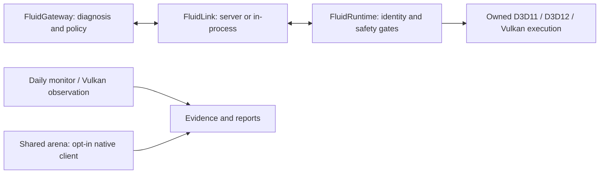

# FluidRuntime

**Less redundant work between CPU, GPU and memory.**

[](https://github.com/maxhuntert1414-max/FluidRuntime/actions/workflows/ci.yml)
[](https://github.com/maxhuntert1414-max/FluidRuntime/actions/workflows/fluidlink.yml)
[](LICENSE)
[](docs/daily-use.md)

A Windows runtime for process monitoring, cooperative graphics experiments and
bounded memory sharing. Native work runs in **C++20**; **C#/.NET** coordinates
identity, budgets, expiry and rollback.
[FluidGateway](https://github.com/maxhuntert1414-max/FluidGateway) supplies diagnosis
and policy. FluidRuntime validates and executes the allowed action.

[Get started](#try-it) | [Documentation](docs/README.md) | [Evidence](docs/STATUS.md) | [Roadmap](docs/roadmap.md) | [Contribute](CONTRIBUTING.md)

## Try It

From a source checkout on Windows with the **.NET 10 SDK**:

```powershell
dotnet run --project src/FluidRuntime -c Release -- processes
dotnet run --project src/FluidRuntime -c Release -- monitor --pid 1234 --cpu-only
```

Replace `1234` with a PID from the list. This monitors CPU/RAM, writes a bounded
JSON report and stops with Ctrl+C without closing the application.
**Monitoring is read-only, not automatic optimization.**

For GPU/VRAM counters and use without Python or a separate .NET installation,
[build the portable package](docs/daily-use.md#build-a-portable-package).
The current daily package is source-built; the older tagged release is not a
download of all features on `main`.

## What Works Today

| Capability | Scope |
| --- | --- |
| **Daily monitoring** | CPU/RAM plus optional native GPU-engine and dedicated/shared memory counters |
| **D3D11 / D3D12 / Vulkan** | Owned workloads with exact-content copy elision, invalidation and original-copy fallback |
| **Application observation** | Opt-in Vulkan launch layer; tracks memory, commands and completion without removing external GPU calls |
| **Shared arena v1** | Experimental D3D12 buffer DLL, C ABI, 64 slots, 64 MiB charged backing and verified read-only peers |
| **Gateway connection** | Isolated FluidLink server or opt-in in-process DLL using the same decision core |
| **Windows priority lease** | Explicit, short Normal-to-AboveNormal lease with an independent restoration watchdog |

See [current status](docs/STATUS.md) for versions, validation and compatibility limits.

## Memory Work, With Evidence

The [shared arena](docs/shared-arena.md) owns CPU sections and
UPLOAD/DEFAULT/READBACK buffers, tracks content versions and makes access lifetime
explicit. Expired leases or unproven GPU completion stop new work.

Its allocation-reuse lab creates **120 backing objects instead of 960** across
the measured workload: **87.5% fewer creations**. Both arms still perform the
same CPU/GPU copies and compare every byte.
[Methodology, timing results and raw reports](docs/evidence/shared-arena.md).

This is a foundation for smarter data reuse, **not physical unified memory**.
It is not loaded by the daily monitor or applied automatically to other programs.

## How the Pieces Fit



The arena's local read-descriptor protocol is separate from FluidLink and grants
no new GPU-control authority. [Architecture and contracts](docs/architecture.md).

## Direction and Boundaries

The goal is to coordinate data lifetime and processing with less redundant work,
especially where memory and hardware are constrained. Next comes trusted
managed/native arena integration, then separately authorized reuse with measured
benefit and a working fallback.

Today this is **not** a general game optimizer, driver, replacement Windows
scheduler or existing-process injector. Protected/anti-cheat applications are
unsupported. Synthetic results do not establish FPS, input-delay, power or
physical PCIe savings. [Full roadmap](docs/roadmap.md).

## Build With Us

Start with [contributing](CONTRIBUTING.md) for setup, formatting and test gates.
Useful contributions include reproducible bug reports, compatibility traces,
failure-path tests and documentation. Negative results are welcome too.

Open source under the [MIT License](LICENSE).
